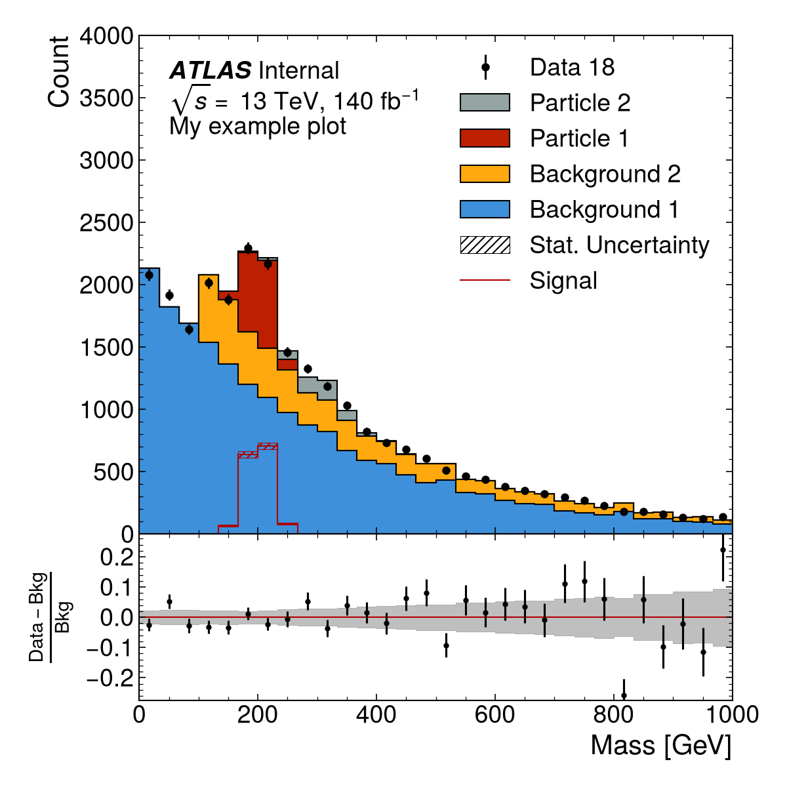

ATLAS Matplotlib Style
======================
.. image:: https://img.shields.io/pypi/v/atlas-mpl-style?label=PyPI&style=for-the-badge
   :alt: PyPI
   :target: https://pypi.org/project/atlas-mpl-style/

Provides a Matplotlib style replicating that used by the
`ATLAS <http://atlas.cern>`__ collaboration, along with a rich set of functionality to make various types of publication-ready plots following the ATLAS guidelines.

**Please open an issue if you find this style deviates from the guidelines.**

Install from PyPI using pip: :code:`pip install atlas-mpl-style`

See the reference documentation for more details: https://atlas-mpl.readthedocs.io/en/latest/index.html

Agent Skill
-----------

This repository includes an ``atlas-mpl-plots`` skill that teaches coding agents
how to make and check Python plots with ``atlas_mpl_style``. Install
``atlas-mpl-style`` in the Python environment your project uses, then install
the skill into your agent:

- **Antigravity**:

  .. code:: sh

     agy plugin install https://github.com/beojan/atlas-mpl

- **Claude Code**:

  .. code:: sh

     claude plugin install atlas-mpl-plots --marketplace beojan/atlas-mpl

- **Codex** (run inside a Codex prompt):

  .. code:: text

     $skill-installer install https://github.com/beojan/atlas-mpl/tree/main/skills/atlas-mpl-plots

