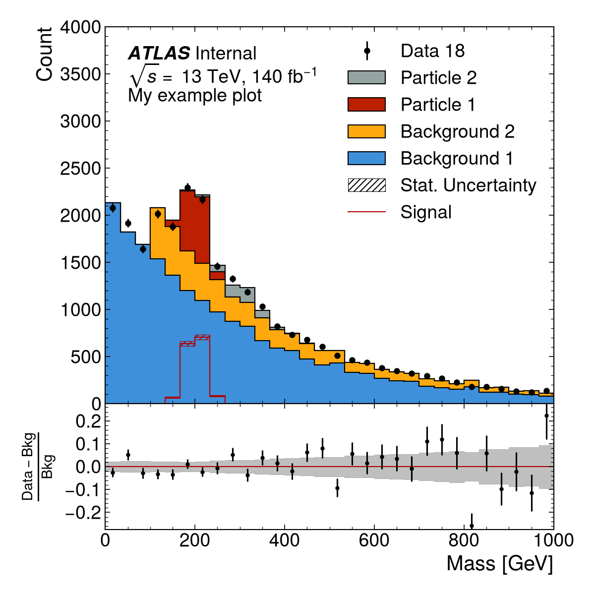

Stacked Histogram with Ratio
============================

This example shows how to make a plot with data, stacked MC components, an
overlaid representative signal, and a ratio panel.

First, load the required packages.

.. code:: python

    import numpy as np
    import matplotlib.pyplot as plt
    import scipy.stats.distributions as dist
    import boost_histogram as bh

Make Histograms
---------------

Generate example Boost histograms. You can also read a ``TH1`` from a ROOT file
with Uproot or pass ``hist.Hist`` objects, as long as they follow the UHI
``PlottableHistogram`` protocol.

.. code:: python

    rng = np.random.default_rng()
    bkg1_dist = dist.expon(0, 3)
    bkg2_dist = dist.expon(1, 3)
    part1_dist = dist.norm(2, 0.2)
    part2_dist = dist.norm(3, 0.4)

    bkg1_data = 100*bkg1_dist.rvs(20000, rng)
    bkg2_data = 100*bkg2_dist.rvs(5000, rng)
    part1_data = 100*part1_dist.rvs(1500, rng)
    part2_data = 100*part2_dist.rvs(500, rng)

    x_axis = bh.axis.Regular(30, 0, 1000)
    bkg1_h = bh.Histogram(x_axis).fill(bkg1_data)
    bkg2_h = bh.Histogram(x_axis).fill(bkg2_data)
    part1_h = bh.Histogram(x_axis).fill(part1_data)
    part2_h = bh.Histogram(x_axis).fill(part2_data)

    data_h = (bh.Histogram(x_axis)
                .fill(100*bkg1_dist.rvs(20000, rng))
                .fill(100*bkg2_dist.rvs(5000, rng))
                .fill(100*part1_dist.rvs(1500, rng))
                .fill(100*part2_dist.rvs(500, rng)))

Make Plot
---------

Load ``atlas_mpl_style`` and activate the ATLAS style before creating the
figure.

.. code:: python

    import atlas_mpl_style as ampl
    ampl.use_atlas_style()

Set up the axes. ``ratio_axes()`` splits the figure into a main panel and a
ratio panel below it that shares the x-axis with no vertical gap.

.. code:: python

    fig, ax, rax = ampl.ratio_axes()
    ax.set_xlim(0, 1000)
    ax.set_ylim(0, 4000)

Plot the stacked MC histograms. Stacked components are passed as ``Background``
objects even when a component is not a physics background. The returned
``(total_hist, total_err)`` tuple is passed to ``plot_ratio`` below. Unlike the
other UHI histogram helpers, ``plot_backgrounds`` lives in ``ampl.plot`` and
accepts ``Background`` objects built from either arrays or UHI histograms.

.. code:: python

    bkg = ampl.plot.plot_backgrounds([
        ampl.plot.Background(label="Background 1", hist=bkg1_h),
        ampl.plot.Background(label="Background 2", hist=bkg2_h),
        ampl.plot.Background(label="Particle 1", hist=part1_h),
        ampl.plot.Background(label="Particle 2", hist=part2_h),
    ], ax=ax)

Next, plot the data, an overlaid signal, and the ratio panel. ``plot_signal``
draws an unfilled histogram layered on top of the stack rather than added to it.
If you are plotting a fitted signal whose normalization relative to the other
components is meaningful, include it in the ``Background`` list instead.

.. code:: python

    ampl.uhi.plot_data(hist=data_h, label="Data 18", ax=ax)
    ampl.uhi.plot_signal(label="Signal", hist=part1_h, color="paper:red")
    ampl.uhi.plot_ratio(data_h, bkg, ratio_ax=rax, plottype='diff')

Set the axis labels. Passing the main ``Axes`` to ``ampl.set_xlabel`` places the
x-axis label below the ratio panel automatically.

.. code:: python

    ampl.set_xlabel("Mass [GeV]", ax=ax)
    ampl.set_ylabel("Count", ax=ax)

    # Use rax.set_ylabel directly so the ratio label is centre-aligned
    rax.set_ylabel(r"$\frac{{Data} - {Bkg}}{{Bkg}}$")

Draw the ATLAS label and the legend. When components are drawn with the package
helpers, ``ampl.draw_legend`` orders the entries automatically (including
``"Stat. Uncertainty"`` here from the signal's statistical band).

.. code:: python

    ampl.draw_atlas_label(0.05, 0.95, ax=ax, status='int', simulation=False, energy='13 TeV', lumi=140, desc="My example plot")
    ampl.draw_legend(ax=ax)  # Pass ncols=2 for a two-column legend when space allows

Save the figure.

.. code:: python

    fig.tight_layout()
    plt.savefig('test.png', dpi=150)

Output
------

